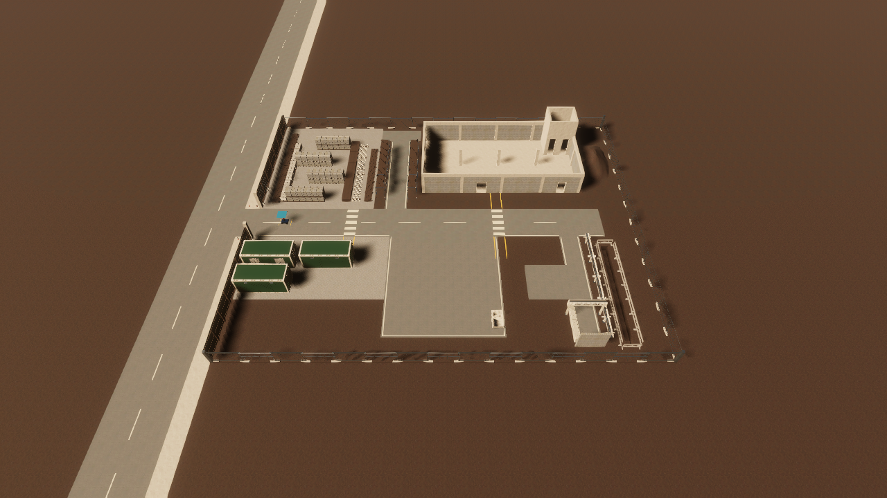
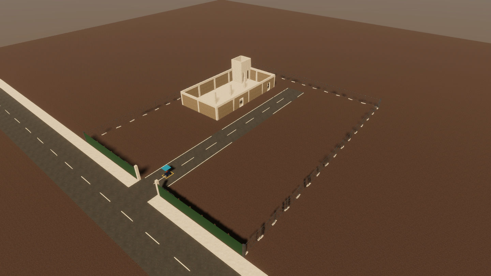
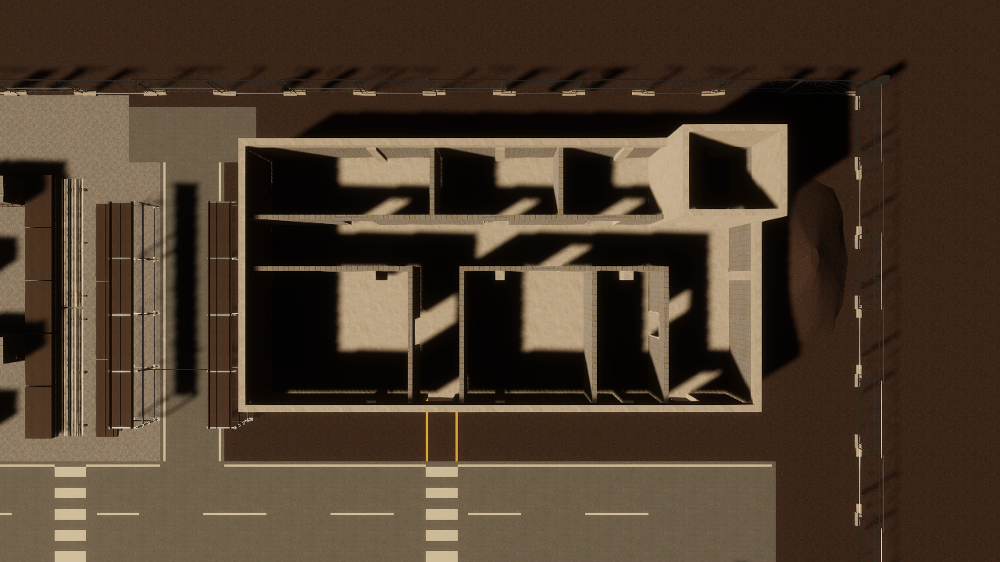

# Construction site V2

`ConstructionSiteV2` is the second benchmark site: a 50 x 40 m organized construction site with
zones, marked lanes and every test feature of the site overhaul brief. V1 (`ConstructionSiteV1`,
`config/scenarios.yaml`, `maps/construction_site.*`) is unchanged; the frozen baselines (tag
`baselines-2026-10-13`) ran on it. Design: `docs/superpowers/specs/2026-10-16-construction-site-v2-design.md`;
decision: [ADR 0012](../../adr/0012-site-selection-and-box-proxies.md). The V2 numbers here are
smoke-run results, not baseline numbers; the comparability-log row in `docs/roadmap.md` stays
provisional until the final baseline run.

## Frame and map

ROS map frame centred on the site: x -25 to 25 m, y -20 to 20 m, origin [-25, -20], 0.05 m cells
(1000 x 800). Default spawn on the spine near the gate at (-21, 0, yaw 0). Exports (package
`mobile_manipulator_navigation`, `maps/`): `construction_site_v2.pgm|yaml|boxes.yaml|metadata.json`
(632 colliders in the metadata).

The 2D map band is per site. V1 keeps 0.02-3.2 m. V2 rasterizes colliders whose vertical extent
intersects 0.02-0.60 m (B5's base band top; base box 0.32 m, arm mount 0.50 m). The planning boxes
keep 0.02-3.2 m for both sites. So overhead members (the H1 ledger, the H3 pipe bridge) and door
heads are not in V2's 2D map, as V1's overhead scenario boxes were not. B1-B4 still see them
through their 0.05-2.0 m lidar and local-costmap band (as a lane-blocking obstacle, see the smoke
runs); B5 knows them in 3D from the planning boxes.

## Zones

| Zone | Where (ROS map frame) | Contents |
|---|---|---|
| Perimeter | x -25..25, y -20..20 | Hoarding and mesh fence; vehicle gate on the west side (y -2.5..2.5); rumble strips inside the gate (Tier 2) |
| Spine road | x -25..21, y -2.5..2.5 (5.0 m) | Asphalt haul road with markings; road plates at x 9..11 (Tier 2); zebra crossings for W1 and W2 |
| Laydown yard | x -23..-9.5, y 2.5..18 | Gravel, chicane aisle through four staggered tall stacks, low pallet stacks 0.6-1.0 m, timber and rebar on bearers |
| Scaffold tunnel | lane x -8..-5, y 2.5..17 | Scaffold bays both sides, H1 ledger at y 7, cable protector at y 4.0..4.4 (Tier 2), turnaround pocket x -9.5..-3.5, y 16.6..19.2 with a gravel patch (Tier 2) |
| Building | x -3..19, y 5.5..17 | CMU blockwork shell, columns, stair and lift core, two south doors (1.30 m door A at x 5.275, 1.05 m door B at x 16.275), fit-out below |
| Office and welfare | x -23..-10, y -10.5..-5 | Three 20 ft cabins on gravel |
| Walkways | W1 x -13..-11.5, W2 x 4.525..6.025 | W1 laydown to welfare; W2 is aligned with door A (forecourt to delivery yard) |
| Delivery yard | x -7..7, y -17..-2.5 | Open area at least 8 x 8 m kept clear (declared as 12.4 x 8 m plus a strip), skip, serpentine store in the south, mud patch (Tier 2) in store aisle 2 |
| Services corridor | lane x 15..17.6 (2.6 m), y -18..-2.5 | Pipe rack along x 18.2, H3 pipe bridge at y -14, block barriers, turn bay x 10..15, y -12..-7, dead end at y -18 |
| Tier 1 terrain | spoil heap x 19.6..24.4, y 8..16; trench x 20.5 | Stepped box proxies on the heap; the trench sits inside proxied barriers |

Building fit-out (blockwork partitions, full height 3.0 m): corridor C1 (2.0 m) north from door A,
hallway H (2.0 m, y 11.6..13.6) opening east into the east bay E, rooms R1 and R2 south of the
hallway, store S (2.85 m wide dead end, 1.05 m door), rooms R3-R5 north of it. Doors: R1, R2, R3 and
R5 1.30 m; R4, S and door B 1.05 m. Door A keeps more than 5 m straight inside (about 8 m) and door B
7.8 m.

Door approach lanes: precast block barriers (`barrier_block_0p8`: 2.5 m long, 0.55 m wide, 0.8 m high,
so in the 2D map band and every lidar band) line both sides of a 1.6 m lane on each south door's axis,
from the wall face to y 3.0. The lane is declared clear from the spine edge (y 2.5) to the door frame;
walkway W2 runs inside door A's lane. Without them the B5 base-only route (Lattice) cut from the spine
to door B at 45 degrees and straightened only 0.45 m before the wall; in a recorded B5 run the robot
reached the 1.05 m opening 4 degrees off-axis and 7 cm off-centre, and the collision monitor's stop
zone (base plus 0.05 m, 0.87 m wide) touched a jamb and stopped it for good. The brief asks for a
straight approach of at least 3 m; the forecourt is 3 m deep, so the barriers run 2.5 m and the lane's
last 0.5 m opens on to the spine. With the lanes, the base-only Lattice plans from 15 spine starts are straight (0.0 degrees) for 2.3 m or more
before the wall. Both door axes sit on a 5 cm map cell centre (x 5.275 and 16.275; the map origin is x -25): with
the axes on a cell boundary the Lattice line fell on either side of the axis (0 or 5 cm off). Now the plan is
2.5 cm off the axis from every spine start (0 cm from a start on the axis, 4.5 cm from one off-grid start),
because the Lattice path poses lie on the 5 cm lattice x = -25 + 0.05 k, not on cell centres. 1.6 m is the brief's lane minimum: the base (0.77 m wide) has 0.42 m a side,
the home and carry footprints (1.24 m) have 0.18 m, so the missions' reconfiguration stops in the lanes
still fit ([door A lane](screenshots/v2-door-a-lane.png), [door B
lane](screenshots/v2-door-b-lane.png)).

Delivery-yard store: three rows of plywood hoarding on feet, 2.2 m aisles, a U-turn gap and a
dead end in aisle 2.

Screenshots: [gate](screenshots/v2-gate.png), [spine](screenshots/v2-spine-asphalt.png),
[spine east](screenshots/v2-spine-east.png), [laydown aerial](screenshots/v2-laydown-aerial.png),
[chicane](screenshots/v2-laydown-chicane.png), [cabins and W1](screenshots/v2-cabins-w1.png),
[scaffold tunnel and H1](screenshots/v2-scaffold-tunnel-h1.png),
[building doors](screenshots/v2-building-doors.png), [building walls](screenshots/v2-building-walls.png),
[forecourt and W2](screenshots/v2-forecourt-w2.png), [fit-out plan](screenshots/v2-fitout-plan.png),
[hallway](screenshots/v2-fitout-hallway.png), [door R4](screenshots/v2-fitout-door-r4.png),
[store S](screenshots/v2-fitout-store-s.png), [delivery yard](screenshots/v2-delivery-yard.png),
[yard store aerial](screenshots/v2-yard-store-aerial.png), [yard store aisle](screenshots/v2-yard-store-aisle.png),
[services bridge](screenshots/v2-services-bridge.png), [spoil heap](screenshots/v2-spoil-heap.png),
[trench](screenshots/v2-trench.png).

## Kit and proxy rule

The scene is built from a grid-aligned modular kit. `tools/site_kit/kit_v2.json` is the single spec
(piece dimensions, box proxies, materials, overhead heights); the headless Blender scripts in
`tools/blender/site_kit/` and the Unity builder both read it. The layout is typed C# in
`motion-planning-sim/Assets/Scripts/Runtime/Environment/SiteKit/SiteV2Layout.cs` (and
`SiteV2Layout.Interiors.cs`); the builders are `SiteKit.cs` and `ConstructionSiteV2Builder.cs` in
`Scripts/Editor`. The meshes (`Assets/SiteKit/Meshes`), materials and textures are committed, so a
host without Blender still builds the full site. The kit has 34 pieces (29 with a Blender mesh, the rest Unity primitives). Previews of the meshed pieces:
[contact sheet](kit-previews/_all.png) and one PNG per piece in `kit-previews/`.

Rule: visual meshes have no colliders. Each piece carries box proxies under
`Environment/NavigationObstacles/<Zone>/<Piece>`; physics, the lidar, the map and boxes exports and
every planner see those boxes and nothing else (ADR 0012). Proxies enclose the mesh and are never
smaller than it (under 0.02 m of error on square sections, one box per round pipe). Every build
runs `validate_construction_site_v2`: proxies inside the map, no unintended intersections,
everything above 0.01 m resting on something, door clear widths, straight approaches, lane widths,
the open area and H1-H3 against the pose heights. Pure decoration lives in `Environment/HandDressing`,
which the builder never touches. The Megascans dressing references scans under
`motion-planning-sim/Assets/Models/`, which is git-ignored (as in V1), so those props appear only on
hosts that have the scans.

Textures (CC0, 1K): asphalt (plain), compacted ground, gravel (laydown yard and cabin areas),
concrete, CMU blockwork, timber, galvanized and painted steel, plastic, cabin paint.

## Overhead heights

Bottom-of-member heights from forward kinematics of the qualified poses (`tools/site_kit/overhead_heights.py`,
written to the kit spec):

| Pose | Panel top |
|---|---|
| `home` | 1.565 m |
| `vertical_carry` | 1.920 m |
| `carry` | 1.320 m |
| `lowered` (lowest qualified held pose) | 1.458 m |

| Member | Bottom | Rule |
|---|---|---|
| H1 scaffold ledger | 1.42 m | carry top + 0.10 m; at least 0.10 m below the home and vertical-carry tops. Only `carry` passes under it |
| H3 pipe bridge | 2.40 m | Every pose passes (control) |

H2 (a member that needs reorientation) was dropped on 2026-10-16: no qualified held pose is lower
than `carry`, so none could pass it. It returns when a pose below `carry` is qualified.

## Tier 2 disturbances

Under `Environment/Disturbances`, inactive by default, never exported to the map or the boxes.
Switch them with a scenario's `disturbances: true` or `unity command site_disturbances --enabled true`
(Play only).

| Piece | Height | Place |
|---|---|---|
| Rumble strips | 0.020 m | Spine inside the gate, x -19.8..-18.6 |
| Road plates | 0.025 m | Spine, x 9..11 |
| Cable protector | 0.035 m | Tunnel entrance, y 4.0..4.4 |
| Gravel patch | flush; friction 0.10 / 0.05 | Turnaround pocket |
| Mud patch | flush; friction 0.03 / 0.01 | Delivery yard, store aisle 2 |

The friction patches are 3 mm slabs; the floor combine mode is Minimum, so the patch value wins.
Heights stay at most 0.035 m with chamfered edges, below the lidar's 0.05 m band. The contact
monitor ignores wheel contacts with colliders under `Environment/Disturbances` (driving over them
is intended); other links still count. Measured on the road plates with disturbances on: 102
`/global_costmap/costmap` messages, no occupied cell at the plates.

## Real-time factor

The same B1 open-space drive on both sites, Apple M4 host (details in [smoke-runs.md](smoke-runs.md)):

| Site | Scenario | Real-time factor |
|---|---|---|
| V1 | `open_space_nav` | 1.000 |
| V2 | `v2_open_yard_nav` | 1.004 |

V2 is not slower than V1, so the realtime-sun lighting rig of V1 was kept (no baked lighting).

## Scenario set and expectations

`ros2_ws/src/mobile_manipulator_navigation/config/scenarios_site_v2.yaml` (top-level
`site: construction_site_v2`, 20 scenarios named `v2_*`). All start in the `carry` pose and the
`carry` footprint profile (user decision 2026-10-17); the missions' MoveIt reconfiguration from
carry is not physically qualified. `v2_through_building_mission` makes the loop (reconfigure to
`vertical_carry` on the spine in front of door A, in through door A, C1, hallway and east bay, out through
door B, back along the spine); B3/B4 drive the loop, B5 drives to the final goal only.

Plan-only expectations per footprint profile are in [plan-expectations.yaml](plan-expectations.yaml)
(checked with `python3 tools/check_site_plans.py`, 60 of 60 match). Facts behind them:

- 1.30 m doors admit only the `vertical_carry` footprint under the Lattice planner (3 cm a side for
  the 1.24 m wide home and carry footprints); V1's 1.30 m gate behaves the same with `home`.
- The 2D map has no overhead members, so the H1 ledger never blocks a plan. The execution outcome
  is different: B1-B4 are expected to stop before H1 (their 0.05-2.0 m band marks the 1.42 m ledger
  as a lane-blocking obstacle whatever the arm pose); B5 is expected to pass.
- Door B is reachable only through door A for the home and carry footprints, so the NavFn planner
  can take a 30 m detour through door A.

## Smoke runs

[smoke-runs.md](smoke-runs.md): real-time factor, eight B1/B5 runs on the tunnel, the 1.05 m door,
the chicane and the rough spine, the costmap check on the road plates, MPC timing. They prove the
site works; they are not baseline numbers.

## Findings carried to Phase 4B and later

- B5 stalls about 0.3 m before the 1.05 m door in `vertical_carry` from a carry start (MPC status
  `ok`, near-zero command).
- B1 with RPP ends the chicane at the known RPP rotate deadlock.
- H2 needs a pose below `carry`.
- Still open: a switchable cross-fall, slopes and ramps (Tier 3), worker figures on the mover boxes,
  and one final baseline run on the final site before the thesis tables.

## Rebuild

See `docs/running-the-stack.md`, "Site V2": kit with Blender, scene build, validation and exports.
